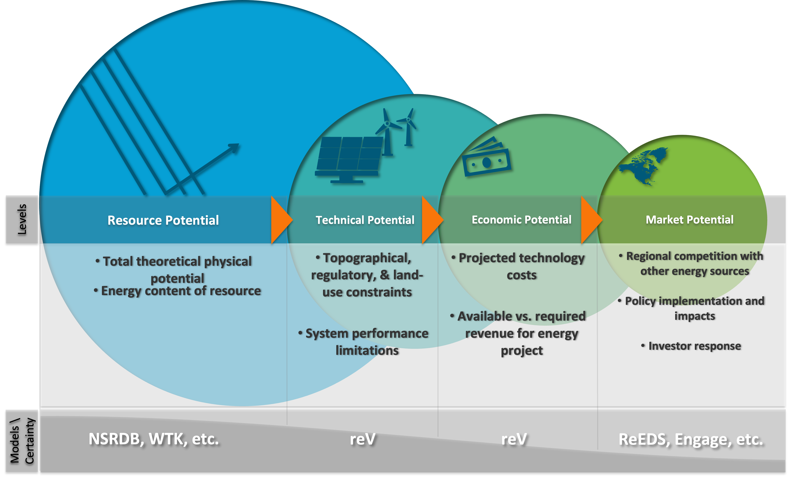
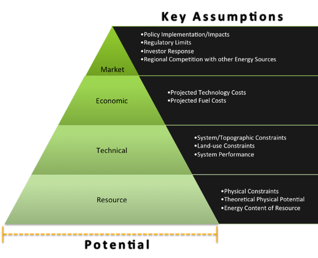
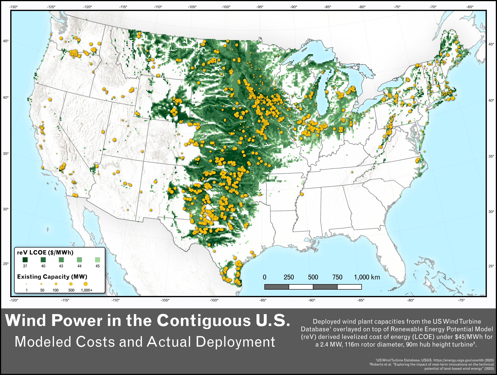
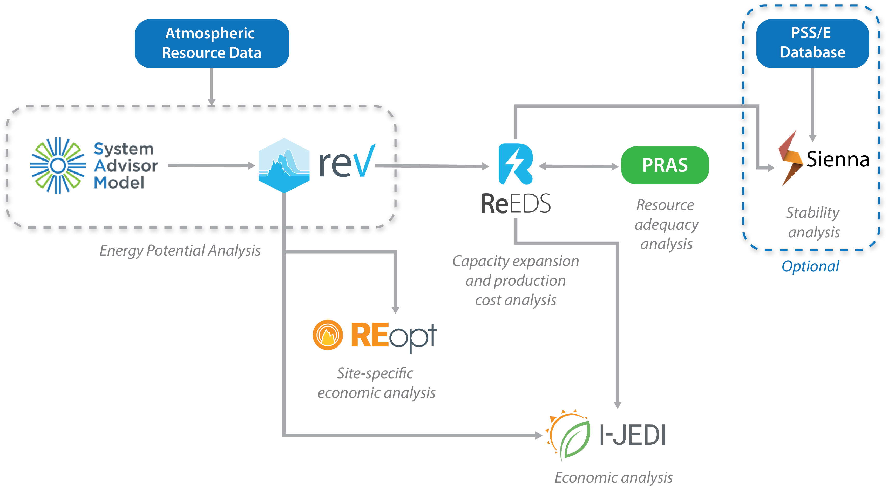
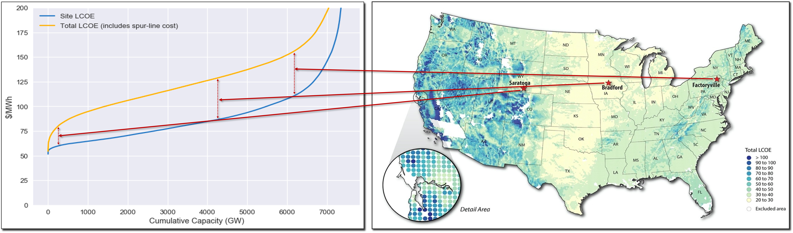
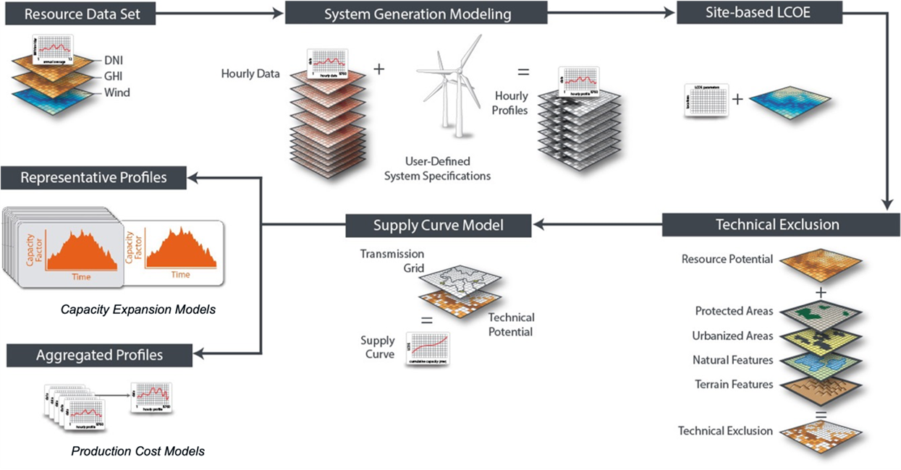

# Technical Potential

> *"It is a truism that everything affects everything else. More specific to the subject at hand are the observations that the evolution of energy demand depends on the supply options available, while the availability of different supply options is itself influenced by the level of energy demand. **Moreover, both depend on environmental constraints, resource constraints, and the like**."*    -Alan McDonald, *Energy in a Finite World (1981)*

We can estimate the amount of radiant energy embedded in the sunlight hitting the earth's surface, or of kinetic energy embedded in the wind driven by it, but how much of that can be converted to useable energy? To develop that estimate, this initial amount of resource must be reduced by how much of it we can realistically access and how much of that we can convert into a useable form (e.g., electricity). This amount is referred to as *"technical potential"*, the estimation of which  is the central purpose of the reV modeling platform. This technical potential may be further reduced by economically viable production cost thresholds, which we refer to as *"techno-economic potential"*. Finally, this third amount can be filtered to an even smaller value that considers the interplay between supply and demand and other social, political, and market variables to represent a realistically deployable amount of generation potential. The reV model is focused only on the technical and techno-economic potential tiers of this assessment model, but is designed to facilitate analysis of the later steps (see Figure 1). Resource assessments serve as an input to reV while its outputs serve as inputs to downstream models. This techno-economic potential will vary widely between generation technologies and geographies, as well as technological and economic assumptions of the future.

  
   
  <em><b>Figure 1.</b> Conceptual diagram of potential energy levels for renewable energy. The bottom bar represents NLR models and relative certainty associated with each level.</em>

### Definitions

There are several definitions or ways of imagining technical potential. An early study, the study quoted above (Häfele et al, 1981), thinks of technical potential by asking:

>"...for each of the different possible energy sources, what **its ultimate technical potential would be if only resource constraints and limitations on technological buildup rates were considered**. Problems of environmental impacts, safety questions, or mismatches between supply and demand patterns are initially assumed essentially solvable, and the constraints of competitive economics are left for Section 4 [1980-2030: Demand, Conservation, and Two Scenarios]."

However, this definition is not quite detailed and specific enough to fully describe technical potenital as estimated by reV. More recent studies, such as the Angliviel et al, 2025 (and also defining economic and feasible/market potential), define technical potential more explicitly as 

 >"...**the amount of electricity that could be produced with current technologies when accounting for geographical and technical limitations as well as conversion efficiencies**; economic potential, which also includes cost; and feasible potential, which accounts for societal and environmental constraints."
]

In the context of the reV model, we will use the definition provided by the authors of its parent study (Lopez et al, 2012) who more specifically identify the categories of constraints used to estimate it (along side economic and market potential): 

>"...**the achievable energy generation of a particular technology given system performance, topographic limitations, environmental, and land-use constraints**. The primary benefit of assessing technical potential is that it establishes an upper-boundary estimate of development potential (DOE EERE 2006). It is important to understand that there are multiple types of potential—resource, technical, economic, and market—each seen in [Figure 2] with its key assumptions."

  
   
  <em><b>Figure 2.</b> An earlier version of the conceptual diagram of potential energy levels for renewable energy. Both this and Figure 1 are based Table 4-1 in the 2011 update of DOE EERE (2006)</em>

The original energy level table in the 2011 Renewable Energy Resource Assessment Report to Congress, as described in Figures 1, 2, and Lopez et al. 2012, is recreated below. This may require a note of clarification considering constraints you may find in more recent assessments of techno-economic potential (e.g., Lopez et al, 2025): regulatory limits that specifically constrain land-use may be considered as technical exclusions to potential development and distinct from the regulatory limits described below as a market constraint. 

| Assessment Category | Purpose | Key Assumptions |
|---|---|---|
| Resource | **Illustrate theoretical physical potential.** Understanding the total energy content of the resource allows for an understanding of the physical potential of renewable resources. | Physical constraints |
| Technical | **Limit potential to incorporate technical and land use challenges.** This type of assessment allows for an understanding of renewable energy potential with realistic land use and technology capabilities, but without the economic and market restrictions that can be altered through policy decisions and market changes. Variations in technical potential may result depending on whether current technology performance, projected performance, or theoretical limits to performance are used. | Technology development limitations; land use; time frame of scenario |
| Cost | **Limit potential by incorporating cost information.** Assumptions related to project costs have a high amount of uncertainty and can change rapidly, so projections must be clear and consistent regarding the assumptions of projected cost. | Cost analysis; projected technology and fuel costs |
| Market | **Limit the potential by incorporating market barriers (interconnection issues, private investment, consumer response, etc.).** Market dynamics are difficult to predict. Often, these are best suited to be set up as comparisons between a well-defined "business as usual" case and a specific policy or consumer-behavior case. Studying the interaction of multiple market changes is complicated because it requires a large number of assumptions, which lead to uncertainty in results. | Policy implementation and impacts; regulatory limits; consumer response and investor response |

<em><b>Table 1.</b> Descriptions of each level represented in the original formulation of potential energy underpinning reV (Originally Table 4-1 in the 2011 update of DOE EERE (2006))</em>

## The Renewable Energy Potential Model

The Renewable Energy Potential model (abbreviated as reV with the "V" refering the physics term electrical potential) is designed to provide large scale and detailed estimates of techno-economic potential for use in energy resource assessments. In general, the outputs of reV represent the top-evel capacity and generation potential for a given technology in a given place as well as the costs associated with these amounts. The output data comes in two basic varieties: 1) summary tables describing techno-economic characteristics across a field of potential sites ("supply curves") and 2) the potential energy generation timeseries ("representative profiles") associated with each site. It is designed to be as flexible as possible and these outputs may be provided at any spatial and temporal resolution the reV analyst has input data for. 

Users may be interested in the direct outputs of reV, to the degree that a theoretical maximum potential estimate is useful, or they may wish to use these as inputs in downstream models. For example, when combined with cost thresholds, it can be useful to use reV to identify areas where development may be economically feasible. See Figure 3 for an illustration of this: here the levelized costs of energy production (LCOE) for a turbine were modeled with reV, filtered by a pre-determined threshold of viability at $45/MWh, and mapped with existing plant locations. In this case, the field of techno-economic potential lined up well with the locations of actual wind plants, despite the use of only a single "baseline" turbine design. Increased energy capture efficiency and lower per unit costs of future turbines may also be modeled, revealing their potential to expand wind into new areas of economic viability. Additionally, because reV is modular (as described below), analysts can use reV for a variety of different use cases and output types. 

  
   
  <em><b>Figure 3.</b> reV-derived techno-economic potential outputs filtered at $45/MWh and mapped with existing locations of wind plants in the continguous United States.</em>

One of the more common uses of reV is to develop the field of possible plants (the supply curve described below) for capacity expansion models such as the Regional Energy Deployment System (ReEDS), and reV has been co-developed with ReEDS over many years. However, there are many downstream applications. Figure 4 represents a subset of model connections used at the Strategic Energy Analysis Center (SEAC) of NLR. It shows the reV-SAM modeling pair situated near the base of the network, connecting directly or indirectly to capacity expansion, resource adequacy, economic, and stability analysis tools.

  
   
  <em><b>Figure 4.</b> Input/output connections between a subset of energy system models at NLR's Strategic Energy Analysis Center.</em>

# The Supply Curve

A "supply curve" in reV terminology refers to a set of individual potential model farms characterized by capacity, generation, and costs. This is the standard target output for a reV run. A common way to visualize this dataset is to sort it by costs (e.g., LCOE) and plot cumulative capacity. This enables a user to quickly see how much capacity exists under any cost threshold. Figure 5 shows an example supply curve 

  
   
  <em><b>Figure 5.</b> A illustrative supply curve representing LCOE both as a cumulative capacity plot and a map. Sample locations are associated with their points along the cumulative capacity curve (representing costs with and without spur-line connections).</em>

### Levels of Detail

A valuable characteristic of reV is the level of detail it enables. However, because of the various input datasets required to build a reV supply curve, there are many different spatial scales that must be reconciled. How this is done will be described in the subsequent tutorials, but to give an idea of the types of resolutions we are working with, a typical reV run with begin with a 2-4 km gridded resource dataset (4 to 16 km2), use a 90m national land use grid (~0.0081 km2) , and ultimately re-aggregate to an output that could represent a typical solar farm in, say, a 3 km2 grid (~9 km2), a wind farm in an 11.5 km grid (~132 km2), or any other scale appropriate for the target technology or desired by the user. 

  
   
  <em><b>Figure 6.</b> An illustration of the various levels of spatial detail represented in the reV model.</em>

## Resource Data

The resource data used in reV represents the theoretical availability of a renewable energy across an area over time. It also quantifies the energy content of a resource at any specific location. There are several resource datasets developed at NLR for understanding, including the National Solar Radiation Database (NSRDB) (Sengupta et al. 2018, Figure 7), the Wind Integrated National Dataset Toolkit (WTK) (Draxl et al. 2015, Figure 8), Geothermal Resource Data (e.g., Zuckerman et al, 2025, Figure 9), and others:

  
   
  <em><b>Figure 7.</b> The National Solar Radiation Database and its contributing radiation datasets.</em>

  
   
  <em><b>Figure 7.</b> Global Coverage for the various NLR Wind Resource Datasets.</em>

  
   
  <em><b>Figure 8.</b> Development suitability for enhanced geothermal systems in the United States.</em>

## reV's Modular Design

Another import characteristic of reV to note is its highly modular design. The outputs of each module are piped as inputs into the next module (as illustrated in Figure 9 below) and the user may stop at any point in the process. This increases the flexibility of reV for users. For example, a user may stop at the "System Generation Modeling" (the reV-generation module) if they are not interested in land use or transmission or they may stop at the supply curve step (reV-supply-curve) if they only require average capacity factors after the land use step (reV-supply-curve-aggregation) and don't need the final time series data. Additionally, this allows for branching scenario modeling. The user may build a set of generation outputs for a range of future technological advancement scenarios and then may build a number of supply curves from each of those for a range of land access or regulatory scenarios. This is described in more detail on the landing page for the reV-tutorial, whose sub-tutorials will generally follow the reV modeling pipeline order.

  
   
  <em><b>Figure 9.</b> The standard modular flow in the reV modeling pipeline.</em>

# References

Angliviel de La Beaumelle, Nils, Kornelis Blok, Jacques A. de Chalendar, Leon Clarke, Andrea N. Hahmann, Jonathan Huster, Gregory F. Nemet, Dhruv Suri, Thomas B. Wild, and Inês ML Azevedo. "The global technical, economic, and feasible potential of renewable electricity." Annual Review of Environment and Resources 48, no. 1 (2023): 419-449.

DOE Office of Energy Efficiency and Renewable Energy (EERE). (October 2006, updated January 2011). “Report to Congress on Renewable Energy Resource Assessment Information for the United States.” January 2011 (EPACT) Prepared by the National Renewable Energy Laboratory.

Draxl, Caroline, Andrew Clifton, Bri-Mathias Hodge, and Jim McCaa. "The wind integration national dataset (wind) toolkit." Applied Energy 151 (2015): 355-366.

Häfele, Wolf, Jeanne Anderer, Alan McDonald, and Nebojsa Nakicenovic. Energy in a Finite World: Paths to a Sustainable Future (Volume 1). Vol. 1. Ballinger, 1981.

Lopez, Anthony, Billy Roberts, Donna Heimiller, Nate Blair, and Gian Porro. US renewable energy technical potentials: a GIS-based analysis. No. NREL/TP--6A20-51946. National Renewable Energy Laboratory (NREL), Golden, CO (United States), 2012.

Roberts, Owen, Travis Williams, Anthony Lopez, Galen Maclaurin, and Annika Eberle. Exploring the impact of near-term innovations on the technical potential of land-based wind energy. No. NREL/TP-5000-81664. National Renewable Energy Laboratory (NREL), Golden, CO (United States), 2023.

Sengupta, Manajit, Yu Xie, Anthony Lopez, Aron Habte, Galen Maclaurin, and James Shelby. "The national solar radiation data base (NSRDB)." Renewable and sustainable energy reviews 89 (2018): 51-60.